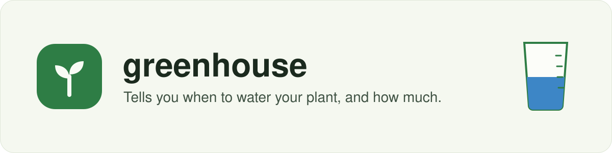
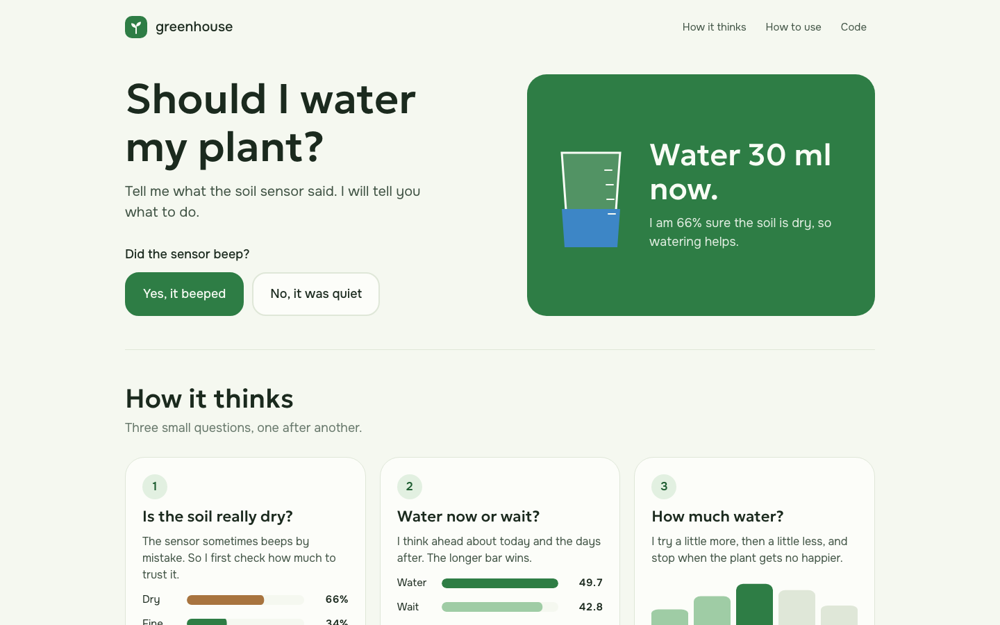
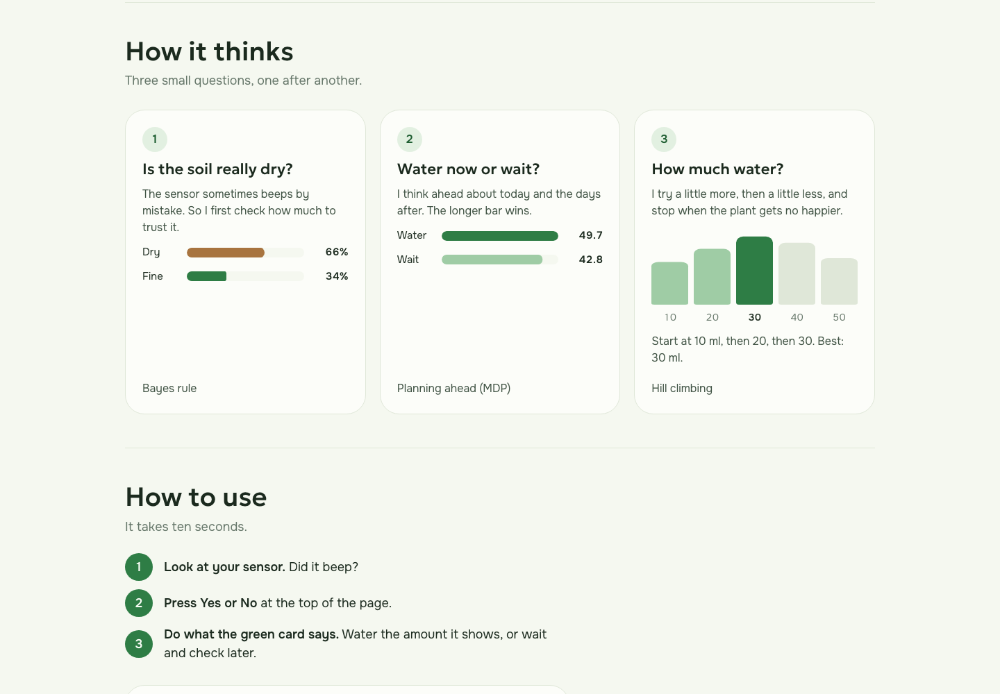

<p align="center">
  
</p>

<p align="center">
  <a href="https://github.com/lordwateroff/greenhouse-ai/actions/workflows/tests.yml"></a>
  
  <a href="LICENSE"></a>
</p>

## What is this?

A little helper for a plant.

You tell it one thing: **did the soil sensor beep?**
It tells you one thing back: **water now (and how much), or wait.**



**Try it online:** [greenhouse-ai-blue.vercel.app](https://greenhouse-ai-blue.vercel.app)

## How to use the site

1. **Look at your sensor.** Did it beep?
2. **Press "Yes, it beeped" or "No, it was quiet".**
3. **Do what the card says.** A green card means water, and it shows how many ml. A white card means wait.

That is all. If you want to see the math, open **Details for the teacher** at the bottom of the page.

## How it thinks

It asks itself three small questions, one after another.

| | Question | How it answers | Example |
|---|---|---|---|
| 1 | **Is the soil really dry?** | The sensor sometimes beeps by mistake, so it checks how much to trust the beep. *(Bayes rule)* | Beep → 66% sure it is dry |
| 2 | **Water now or wait?** | It thinks about today and the days after, and picks what turns out better. *(MDP, value iteration)* | Water wins, 49.7 vs 42.8 |
| 3 | **How much water?** | It tries a little more, then a little less, and stops when the plant gets no happier. *(Hill climbing)* | 10 → 20 → 30 ml, best is 30 ml |



## Run it on your computer

You need **Python 3.12** and **git**. Open a terminal and type:

```bash
git clone https://github.com/lordwateroff/greenhouse-ai
```

```bash
cd greenhouse-ai && make setup
```

```bash
make dev
```

Now open **http://localhost:8000** in your browser. To stop it, press `Ctrl + C` in the terminal.

No Python 3.12? Get it from [python.org](https://www.python.org/downloads/).

### Other commands

| Command | What it does |
|---|---|
| `make test` | Checks that all the math is right (41 tests) |
| `make cli` | Shows the whole thinking in the terminal, step by step |
| `make experiments` | Prints the result tables from the report |

## Where things are

| Folder | What is inside |
|---|---|
| `greenhouse/` | The brain: the three algorithms in plain Python |
| `public/` | The website |
| `app.py` | The small server that connects the website to the brain |
| `tests/` | Checks for the math |
| `docs/` | Report, slides, defense notes |

<details>
<summary><b>Details for the teacher</b></summary>

All numbers are made-up assumptions, set by hand in [`greenhouse/config.py`](greenhouse/config.py).

**1. Bayes.** Prior P(Dry) = 0.30, P(alert | Dry) = 0.90, P(alert | Normal) = 0.20.

```text
P(Dry | alert)    = 0.90·0.30 / (0.90·0.30 + 0.20·0.70) = 0.27 / 0.41 = 0.6585
P(Dry | no_alert) = 0.10·0.30 / 0.59 = 0.0508
```

**2. MDP.** States Dry, Normal. Actions Water, Wait. γ = 0.9.

| Reward | Water | Wait |
|---|---|---|
| Dry | +6 | −10 |
| Normal | −4 | +5 |

| P(next \| state, action) | → Dry | → Normal |
|---|---|---|
| Dry, Water | 0.1 | 0.9 |
| Dry, Wait | 1.0 | 0.0 |
| Normal, Water | 0.0 | 1.0 |
| Normal, Wait | 0.3 | 0.7 |

Value iteration converges in 148 iterations: Q*(Dry, Water) = 53.14, Q*(Dry, Wait) = 37.82, Q*(Normal, Water) = 43.06, Q*(Normal, Wait) = 52.29. Policy: Dry → Water, Normal → Wait.

The soil state is not known for sure, so each action is scored by the belief (QMDP): Score(a) = P(Dry)·Q*(Dry, a) + P(Normal)·Q*(Normal, a). After a beep: Water 49.69, Wait 42.76 → Water. Without a beep: Water 43.57, Wait 51.55 → Wait. Water wins when P(Dry) > 0.376.

**3. Hill climbing.** Doses 10–50 ml, plant scores 55, 72, 88, 80, 60. From 10 ml: 10 → 20 → 30, best 30 ml (score 88).
Weak spot: with scores 60, 70, 65, 85, 75 it gets stuck at 20 ml (a local maximum). Restarting from every dose finds 40 ml (score 85).

**Limits.** Two soil states only. QMDP instead of a full POMDP. Five doses in a lookup table. No real hardware yet.

Full write-up: [report](docs/report.md) ([PDF](docs/report.pdf)), [slides](docs/presentation.pdf), [defense cheatsheet](docs/defense-cheatsheet.md), [AI usage declaration](docs/ai-usage-declaration.md).

</details>

## Author

Miras Yessenaly, AI Fundamentals final project, 2026. Built with help from Claude Code; see the [AI usage declaration](docs/ai-usage-declaration.md).

[MIT license](LICENSE)
