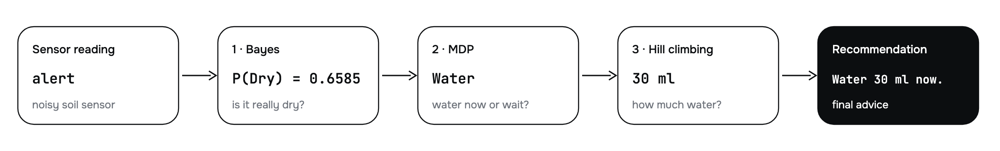
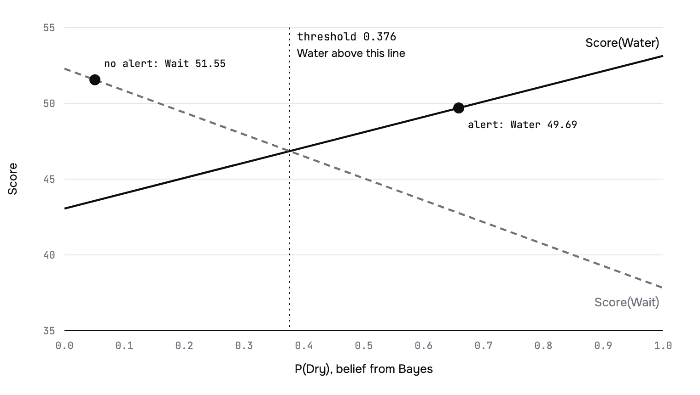
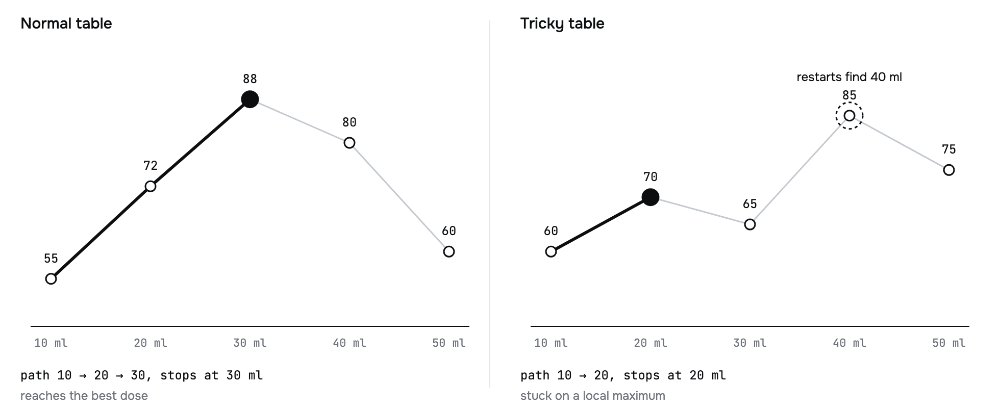

# Mini Greenhouse Assistant

Technical report

AI Fundamentals Final Project

Miras Yessenaly (individual project)

November 2026

Repository: [github.com/lordwateroff/greenhouse-ai](https://github.com/lordwateroff/greenhouse-ai)

Live demo: [https://greenhouse-ai-blue.vercel.app](https://greenhouse-ai-blue.vercel.app)

## Abstract

Cheap soil moisture sensors are noisy. If we trust them blindly, a plant is either overwatered or left dry. The Mini Greenhouse Assistant decides when to water one plant and how much, even when the sensor is unreliable. It chains three algorithms from three different course topics. Bayesian inference turns a sensor reading into a belief that the soil is dry. A Markov decision process (MDP), solved with value iteration, turns that belief into an action: Water or Wait. Steepest-ascent hill climbing picks the best water dose. With the default assumptions, a "dry" alert gives P(Dry) = 65.9 %, the decision is Water, and the dose is 30 ml: "Water 30 ml now." Without an alert, P(Dry) drops to 5.1 % and the assistant waits. The code is pure Python. 41 pytest tests check it, and a small FastAPI app serves it to a vanilla JavaScript site. All numbers are hand-set, hypothetical assumptions, which the course brief allows.

## 1. Problem statement

A small greenhouse has one plant and one cheap soil sensor. The sensor raises an alert when it thinks the soil is dry. It is often right, but not always:

- it catches dry soil 90 % of the time, so 10 % of dry days go unnoticed;
- it raises a false alarm on 20 % of normal days.

Watering has a cost. Too little water and the plant suffers. Too much and the roots rot and water is wasted. Water also has a delayed effect: what we do today changes the state of the soil tomorrow. So the assistant has to answer three questions in order:

1. How likely is it that the soil is really dry, given what the sensor says?
2. Given that belief, is it better to water now or to wait?
3. If we water, how much water is best?

This is topic 04 of the course project list: a greenhouse agent that monitors soil and selects watering, with 5 candidate water levels, 2 soil states and a fixed transition table. The expected output is the best setting, the dry-soil probability and the watering decision.

## 2. Objectives

- Implement three algorithms from three different course topics: probabilistic reasoning (Bayes), sequential decision making (MDP with value iteration) and local search (hill climbing).
- Make them work toward one goal: the output of one step is the input of the next.
- Show, for each algorithm, its input, key steps, output and a one-sentence explanation.
- Label every assumption as hypothetical and keep all of them in one place in the code.
- Provide a working demo: a website that runs online and offline, plus a console demo.
- Verify the results with unit tests that match a hand calculation.
- Show at least one known weakness (a local maximum) and its fix (restarts).

## 3. System overview

The chain is the core of the project. Each arrow carries a real value from one algorithm to the next.



| Step | Question | Input | Output (alert) | Output (no alert) |
|---|---|---|---|---|
| 1. Bayes | Is the soil really dry? | prior, sensor model, reading | P(Dry) = 0.6585 | P(Dry) = 0.0508 |
| 2. MDP | Water now or wait? | P(Dry), rewards, transitions, γ | Water | Wait |
| 3. Hill climbing | How much water? | 5 doses and their scores | 30 ml | 30 ml (kept for later) |
| Result | | | "Water 30 ml now." | "Wait. Check again later." |

When the decision is Wait, the assistant still reports the best dose: "No watering now. When it's needed, the best dose is 30 ml."

## 4. Algorithm 1: Bayesian inference

**In one sentence.** "The sensor says 'dry', but it sometimes lies. Bayes tells us how much to trust it."

**How it works.** We start with a prior: how often the soil is dry before we look at the sensor. Then we ask how likely the reading is in each world (dry or normal). Bayes' rule combines both:

```
P(Dry | obs) = P(obs | Dry) · P(Dry) / P(obs)
P(obs)       = P(obs | Dry) · P(Dry) + P(obs | Normal) · P(Normal)
```

For `no_alert` the likelihoods are the complements: P(no_alert | Dry) = 0.10 and P(no_alert | Normal) = 0.80.

**Why this algorithm.** The sensor gives a yes or no, but the truth is uncertain. We have exactly what Bayes needs: a prior and a sensor model. The result is a probability, not a guess, and the next step needs a probability.

**How it contributes.** It turns a noisy reading into a belief P(Dry) between 0 and 1. That belief is the input of the MDP decision.

**Input → steps → output** (real program output, alert):

| Input (assumed) | Value |
|---|---|
| Prior P(Dry) | 0.30 (so P(Normal) = 0.70) |
| P(alert \| Dry) | 0.90 |
| P(alert \| Normal) | 0.20 |
| Observation | alert |

```
P(alert|Dry)·P(Dry)       = 0.90·0.30 = 0.2700
P(alert|Normal)·P(Normal) = 0.20·0.70 = 0.1400
P(alert)                  = 0.2700 + 0.1400 = 0.4100
P(Dry|alert)              = 0.2700 / 0.4100 = 0.6585  (65.9%)
```

With `no_alert`: P(no_alert) = 0.03 + 0.56 = 0.59 and P(Dry | no_alert) = 0.03 / 0.59 = 0.0508 (5.1 %).

**Key insight.** The sensor is 90 % accurate on dry soil, yet the posterior is only 66 %. Dry soil is rare (prior 30 %), and false alarms on normal days are common, so they make up a large share of all alerts (0.14 out of 0.41).

## 5. Algorithm 2: MDP with value iteration

**In one sentence.** "For each action we ask: what do I get now, plus what can I expect later? We pick the bigger number."

**The model** (all values assumed). States: Dry, Normal. Actions: Water, Wait. Discount γ = 0.9.

| R(s, a) | Water | Wait |
|---|---|---|
| Dry | +6 (plant saved, minus water cost) | −10 (plant suffers) |
| Normal | −4 (overwatering, wasted water) | +5 (all good, water saved) |

| P(s′ \| s, a) | → Dry | → Normal |
|---|---|---|
| Dry, Water | 0.1 | 0.9 |
| Dry, Wait | 1.0 | 0.0 |
| Normal, Water | 0.0 | 1.0 |
| Normal, Wait | 0.3 | 0.7 |

**How it works.** Value iteration starts with V₀ = 0 for every state and repeats the Bellman update:

```
Q(s, a) = R(s, a) + γ · Σ_s′ P(s′ | s, a) · V(s′)
V(s)    = max_a Q(s, a)
```

It stops when the largest change in V is below 10⁻⁶ (limit: 1000 iterations). The policy picks, in each state, the action with the larger Q*.

**Deciding under uncertainty.** The MDP assumes we know the state, but we only have the belief b = P(Dry) from Bayes. So we weigh each action's value by that belief:

```
Score(a) = b · Q*(Dry, a) + (1 − b) · Q*(Normal, a)
```

This is the QMDP approximation. Both scores are straight lines in b, so there is one crossing point. Watering wins when b is above it:

```
gain if dry      = Q*(Dry, Water) − Q*(Dry, Wait)       = 15.3136
loss if normal   = Q*(Normal, Wait) − Q*(Normal, Water) =  9.2288
threshold        = 9.2288 / (15.3136 + 9.2288)          =  0.376
```

In plain words, we water when we are more than 38 % sure the soil is dry.

If the two lines are parallel, they never cross, and the code returns no threshold (`None`). For example, when all four rewards are equal, both actions score the same at every belief. The API then returns no threshold, and the details block on the site shows it as "never".

**Why this algorithm.** Watering is a choice with consequences tomorrow: watering dry soil usually makes it normal, waiting keeps it dry. An MDP models this trade-off between a reward now and the state we end up in. Value iteration is simple, exact for a 2-state model and easy to show step by step.

**How it contributes.** It turns the belief P(Dry) into the action Water or Wait. Without it the assistant would need a cut-off picked by hand. With it, the cut-off (0.376) follows from the rewards and transitions.

**Input → steps → output** (real program output):

| Iteration | V(Dry) | V(Normal) |
|---|---|---|
| 0 | 0 | 0 |
| 1 | 6.00 | 5.00 |
| 2 | 10.59 | 9.77 |
| 148 (converged) | 53.1356 | 52.2881 |

At iteration 2: Q(Dry, Water) = 10.59, Q(Dry, Wait) = −4.6, Q(Normal, Water) = 0.5, Q(Normal, Wait) = 9.77. For example, Q(Dry, Water) = 6 + 0.9 · (0.1 · 6 + 0.9 · 5) = 10.59.

| Q*(s, a), 148 iterations | Water | Wait | Policy |
|---|---|---|---|
| Dry | 53.1356 | 37.8220 | Water |
| Normal | 43.0593 | 52.2881 | Wait |

| Reading | b = P(Dry) | Score(Water) | Score(Wait) | Decision |
|---|---|---|---|---|
| alert | 0.6585 | ≈ 49.7 | 42.76 | Water |
| no alert | 0.0508 | 43.57 | 51.55 | Wait |



## 6. Algorithm 3: hill climbing

**In one sentence.** "Try a bit more or a bit less water. If the plant gets better, keep going that way. If it gets worse, stop." It is like finding the right music volume.

**How it works.** There are 5 candidate doses, each with a plant health score from a lookup table (assumed). Steepest-ascent hill climbing starts at one dose and looks at both neighbours (one index up and one down). It moves to the better neighbour only if it is strictly better than the current dose. Otherwise it stops: it is on a hill top.

```
current = start
repeat:
    best = neighbour of current with the highest score
    if score(best) > score(current): current = best
    else: stop and return current
```

**Why this algorithm.** There is no map and no path to a goal, so path search such as A* or BFS does not fit. We only have "how good is this dose", and neighbouring doses give similar results. Local search is built for this kind of problem. In a real greenhouse each evaluation would be a slow trial on a plant, so it helps to try only nearby doses. With just 5 doses, checking all of them would also work. We keep hill climbing because it scales to finer dose grids and because its weakness is easy to show.

**How it contributes.** It gives the dose. The dose is used only when the MDP says Water.

**Input → steps → output** (real program output, start at 10 ml):

| Dose (ml) | 10 | 20 | 30 | 40 | 50 |
|---|---|---|---|---|---|
| Health score (normal) | 55 | 72 | 88 | 80 | 60 |
| Health score (tricky) | 60 | 70 | 65 | 85 | 75 |

```
start at 10 ml, score 55
neighbours: 20 ml → 72. move to 20 ml
neighbours: 10 ml → 55, 30 ml → 88. move to 30 ml
neighbours: 20 ml → 72, 40 ml → 80. none is better, stop
best dose = 30 ml, score 88, 2 steps
```

**Weakness and fix.** The tricky table (the "Tricky plant" option on the site) has a local maximum. From 10 ml the climber goes to 20 ml (70), sees 60 and 65, and stops, although 40 ml (85) is better. The fix is restarts: climb from several starts and keep the best top. Our version is deterministic. It restarts from every one of the 5 doses, which is cheap with 5 doses, so no randomness is needed. The button on the site still says "Try random restarts", the textbook name. Runs from 30, 40 and 50 ml end at 40 ml, so the best of all runs is 40 ml (score 85), and the recommendation becomes "Water 40 ml now."



## 7. Implementation

**Architecture.**

- `greenhouse/` is a pure-Python package with no web code and no external libraries, not even numpy. Each function returns its answer plus a list of `steps` (status, source, text). The website and the console both print those steps, so the page shows the numbers the code computed. `config.py` holds every default number, each marked `# assumption (hypothetical)`. `bayes.py`, `mdp.py` and `hill_climbing.py` hold one algorithm each. `pipeline.py` runs the chain and builds the final recommendation. `cli.py` prints the whole chain to the console (`python -m greenhouse.cli`), the backup demo. `experiments.py` runs the three experiments in section 8.
- `app.py` is a thin FastAPI layer: `GET /api/health`, `GET /api/defaults`, `POST /api/run` (all fields optional, defaults from `config.py`) and `GET /api/experiments`. Pydantic checks the input: probabilities in [0, 1], γ in [0, 1), transition rows that add up to 1, doses and scores of the same length. Bad input returns a 422 with a readable message.
- `public/` is a vanilla HTML, CSS and JavaScript site with no build step. The bars and dose columns are plain HTML and CSS. The measuring cup, the clock and the logo are inline SVG.
- Deployment: Vercel detects `app.py` and runs it as a Python function, and serves `public/` from its CDN.
- Offline run: `make dev` (or `.venv/bin/python -m uvicorn app:app --port 8000`) serves the API and the site from one process. When not on Vercel, `app.py` mounts `public/` with `StaticFiles`, so the demo works without internet.

**Where to look in the code.**

| What | File and lines |
|---|---|
| Posterior (Bayes' rule) | `greenhouse/bayes.py`, `posterior()` lines 16–61, the rule itself on line 42 |
| Bellman update | `greenhouse/mdp.py`, `q_value()` lines 24–27 |
| Value iteration loop | `greenhouse/mdp.py`, lines 38–45 |
| QMDP decision and threshold | `greenhouse/mdp.py`, `decide_under_belief()` lines 65–88 |
| Hill-climbing step | `greenhouse/hill_climbing.py`, loop on lines 33–43 |
| Restarts | `greenhouse/hill_climbing.py`, `random_restart()` lines 57–75 |
| The chain | `greenhouse/pipeline.py`, `run_pipeline()` lines 14–63 |

## 8. Testing and results

**Unit tests.** 41 pytest tests, all passing (`.venv/bin/python -m pytest -q`). The expected numbers come from the hand calculation above.

| File | Tests | What they check |
|---|---|---|
| `tests/test_bayes.py` | 7 | alert → 0.658537, no alert → 0.050847, evidence 0.41 and 0.59; prior 0 stays 0 and prior 1 stays 1; invalid probabilities (−0.1, 1.5) and an unknown observation raise errors; the last step shows the answer |
| `tests/test_mdp.py` | 9 | V₁ = (6, 5); the four Q values at iteration 2; convergence to V* and Q*; policy Dry → Water, Normal → Wait; decisions and scores at b = 0.6585 and b = 0.0508; threshold 0.376 (Water at 0.38, Wait at 0.37); bad transitions and γ = 1 raise errors; equal rewards give no threshold |
| `tests/test_hill_climbing.py` | 11 | path 10 → 20 → 30, best 30, score 88, 2 steps; every one of the 5 starts reaches 30; the tricky table gets stuck at 20; restarts find 40 (85); a plateau stops; a length mismatch and an unknown start raise errors |
| `tests/test_pipeline.py` | 5 | alert → "Water 30 ml now."; no alert → Wait with 30 ml in the detail; the Bayes posterior is exactly the MDP belief; tricky mode gives 20 ml, with restarts 40 ml; the experiments run and include a Wait on alert |
| `tests/test_api.py` | 9 | health and defaults; `/api/run` with defaults equals the pipeline; an empty body works; no alert flips to Wait; 422 with a clear message for a bad probability, transitions that do not add up to 1, a length mismatch and an impossible observation |

**Experiment 1: decision on an alert for different priors and false-alarm rates.** P(alert | Dry) stays 0.90.

| Prior P(Dry) | P(alert \| Normal) | P(Dry \| alert) | Decision |
|---|---|---|---|
| 0.1 | 0.05 | 0.6667 | Water |
| 0.1 | 0.2 | 0.3333 | Wait |
| 0.1 | 0.4 | 0.2000 | Wait |
| 0.3 | 0.05 | 0.8852 | Water |
| 0.3 | 0.2 | 0.6585 | Water |
| 0.3 | 0.4 | 0.4909 | Water |
| 0.5 | 0.05 | 0.9474 | Water |
| 0.5 | 0.2 | 0.8182 | Water |
| 0.5 | 0.4 | 0.6923 | Water |

When dry soil is rare and the sensor raises many false alarms, the assistant waits even on an alert, because the belief stays below the 0.376 threshold. This is the main reason to weigh the sensor first.

**Experiment 2: hill climbing from every start.**

| Mode | Start (ml) | Path | Stops at | With restarts |
|---|---|---|---|---|
| normal | 10 | 10 → 20 → 30 | 30 | 30 |
| normal | 20 | 20 → 30 | 30 | 30 |
| normal | 30 | 30 | 30 | 30 |
| normal | 40 | 40 → 30 | 30 | 30 |
| normal | 50 | 50 → 40 → 30 | 30 | 30 |
| tricky | 10 | 10 → 20 | 20 | 40 |
| tricky | 20 | 20 | 20 | 40 |
| tricky | 30 | 30 → 40 | 40 | 40 |
| tricky | 40 | 40 | 40 | 40 |
| tricky | 50 | 50 → 40 | 40 | 40 |

On the normal table every start finds 30 ml. On the tricky table 2 of 5 starts get stuck at the local maximum (20 ml). Restarts fix both.

**Experiment 3: Score(Water) and Score(Wait) against P(Dry).** This is Figure 2 as a table.

| P(Dry) | 0.0 | 0.1 | 0.2 | 0.3 | 0.4 | 0.5 | 0.6 | 0.7 | 0.8 | 0.9 | 1.0 |
|---|---|---|---|---|---|---|---|---|---|---|---|
| Water | 43.06 | 44.07 | 45.07 | 46.08 | 47.09 | 48.10 | 49.11 | 50.11 | 51.12 | 52.13 | 53.14 |
| Wait | 52.29 | 50.84 | 49.39 | 47.95 | 46.50 | 45.06 | 43.61 | 42.16 | 40.72 | 39.27 | 37.82 |

Wait is better up to 0.3 and Water from 0.4 on. The exact crossing is 0.376.

All three experiments come from the same code as the app (`python -m greenhouse.experiments`). The API also returns them through `GET /api/experiments`.

## 9. UI/UX

The website is one light page for a person who owns a plant and knows nothing about AI. It asks one question, gives one answer, and then explains the answer in three plain steps. The colours come from the plant itself: a pale green background, leaf green for the main answer and accents, soil brown for the "dry" bar and water blue for the measuring cup. The logo is a small sprout. Headings use Geologica, body text Onest, and code JetBrains Mono. There are no shadows on text, no gradient buttons and no emoji.

- **Question and answer.** The top of the page asks "Should I water my plant?" and "Did the sensor beep?", with two buttons: "Yes, it beeped" and "No, it was quiet". Next to them a large answer card shows the result. For Water it is green, says "Water 30 ml now." and shows a measuring cup filled to the dose. For Wait it is white, says "Wait. Check again later." and shows a clock. One line under the answer gives the reason, for example "I am 66% sure the soil is dry, so watering helps."
- **How it thinks.** Three numbered cards follow the chain. Card 1, "Is the soil really dry?", shows two bars, Dry and Fine, from Bayes' rule. Card 2, "Water now or wait?", shows the Water and Wait scores from the MDP; the longer bar wins. Card 3, "How much water?", shows the five doses as columns, marks the ones the climber visited and the best one, and says the path in words: "Start at 10 ml, then 20, then 30. Best: 30 ml." Each card names its method in a small tag.
- **How to use.** Three short steps for the plant owner, and a "Run it on your computer" box with three commands: `git clone`, `make setup` and `make dev`.
- **Details for the teacher.** A collapsible block, closed by default, keeps the technical part out of the way. It lists the assumed numbers and the water threshold (37.6%). Two checkboxes show the weakness of hill climbing. "Tricky plant" switches to the tricky table, and card 3 says "Stuck at 20 ml, but 40 ml is better. A small hill fooled it." Adding "Try every start" runs the restarts, card 3 says "I tried every start. Best: 40 ml." and the answer becomes "Water 40 ml now." A log, "What the code did", lists the `steps` that the API returned for all three algorithms.
- **States and access.** If the API cannot be reached, a short notice says so, keeps the last answer and offers "Try again". The page works with the keyboard, shows a visible focus ring, announces the answer with `aria-live` and turns animation off under `prefers-reduced-motion`. On a phone the two columns stack into one, with 16 px side margins.
- **Copy.** Short sentences in plain words, written to the plant owner. Formulas and Greek letters appear only inside the details block. Every assumed number is listed there as an assumption.

## 10. Limitations and future work

**Limitations.**

- **Hand-set numbers.** The prior, sensor model, rewards, transitions and dose scores are assumptions, not data. The course allows this, but the decisions are only as good as these numbers.
- **QMDP, not a full POMDP.** Weighing Q* by the belief assumes the uncertainty disappears after one step. A full POMDP would also value actions that gather information, such as checking the sensor again.
- **Deterministic restarts.** Our restart tries every dose instead of random starts. That is exact and cheap for 5 doses, but it would not scale to a large or continuous dose range.
- **One plant, one sensor, one reading.** The belief is not updated over time, and plants do not share water or sensors.
- **Static dose table.** The health score does not depend on the soil state or the weather.

**Future work.**

- Real sensors on an ESP32 or Arduino board, sending readings to the same API.
- Learning the probabilities and dose scores from logged sensor readings and plant outcomes.
- A full POMDP that tracks the belief from day to day and can choose to look before acting.
- Several plants with a shared water budget.

## 11. AI usage

This project was built with the help of Claude Code (Anthropic), under the student's direction. The AI generated most of the code, the website and the documents. The student chose the topic, set the requirements and the numbers, checked the results against a hand calculation and the tests, and is responsible for understanding and defending every algorithm. Details are in the [AI usage declaration](ai-usage-declaration.md).

## References

1. S. Russell and P. Norvig. *Artificial Intelligence: A Modern Approach*, 4th edition. Pearson, 2020. Chapter 4 (local search, hill climbing, random restarts), chapter 12 (probability and Bayes' rule) and chapter 17 (MDPs, value iteration, POMDPs).
2. AI Fundamentals course materials: final project brief and the list of project topics (topic 04, Mini Greenhouse Assistant).
3. M. L. Littman, A. R. Cassandra and L. P. Kaelbling. Learning policies for partially observable environments: scaling up. *Proceedings of ICML*, 1995 (the QMDP approximation).
4. FastAPI documentation. [https://fastapi.tiangolo.com](https://fastapi.tiangolo.com)
5. Vercel documentation, Python and FastAPI deployments. [https://vercel.com/docs](https://vercel.com/docs)
